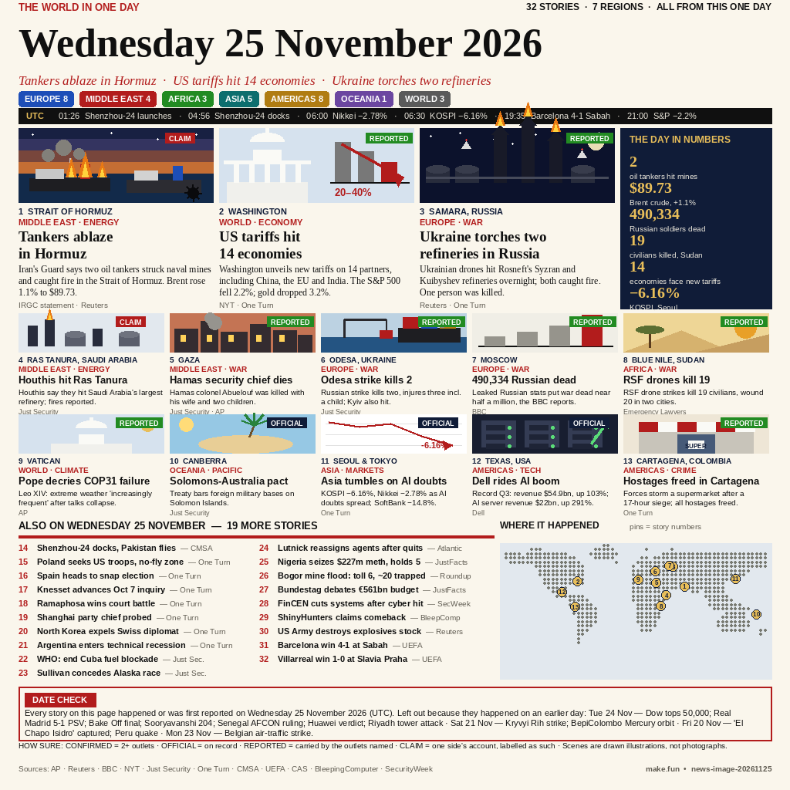

# World News — Wednesday 25 November 2026

[](https://make.fun/bounty/news-image-20261125?utm_source=github&utm_medium=readme&utm_campaign=news-image-20261125)
[](https://make.fun/bounty/news-image-20261125/leaderboard?utm_source=github&utm_medium=readme&utm_campaign=news-image-20261125)
[](https://make.fun/bounty/news-image-20261125?utm_source=github&utm_medium=readme&utm_campaign=news-image-20261125)

Entry for make.fun **news-image-20261125**: “Sum up 25 November's world news in one image”.



One newspaper front page, 1024×1024 PNG, 205,234 bytes, **32 stories in 7 regions** — rebuilt after a teardown of the 22 Nov final winners (rank 1 bagarte 85.44%, rank 2 quiet-puffin-39 83.93%). The v1 text-only format repeated the layout that scored 63.10% on 22 Nov; v2 follows the winners' pattern: code-drawn illustrations for all 3 heroes + 10 medium stories, a DATE CHECK footer, a HOW SURE legend, a THE DAY IN UTC strip, region chips with counts, a numbers strip, a dotted world map with numbered pins, and a source for every story.

- **Lead — Tankers ablaze in Hormuz (CLAIM):** Iran's Guard says two oil tankers struck naval mines and caught fire in the Strait of Hormuz. Brent rose 1.1% to $89.73.
- **Hero 2 — US tariffs hit 14 economies:** Washington unveils new tariffs on 14 partners, including China, the EU and India. The S&P 500 fell 2.2%; gold dropped 3.2%.
- **Hero 3 — Ukraine torches two refineries:** Ukrainian drones hit Rosneft's Syzran and Kuibyshev refineries overnight; both caught fire. One person was killed.
- **Ras Tanura (CLAIM):** Houthis say they hit Saudi Arabia's largest refinery; fires reported.
- **Gaza:** Hamas colonel Abuelouf was killed with his wife and two children.
- **Odesa:** Russian strike kills two, injures three incl. a child; Kyiv also hit.
- **Moscow:** leaked Russian stats put war dead near half a million, the BBC reports.
- **Blue Nile:** RSF drone strikes kill 19 civilians, wound 20 in two cities.
- **Vatican:** Leo XIV — extreme weather 'increasingly frequent' after talks collapse.
- **Canberra:** treaty bars foreign military bases on Solomon Islands.
- **Seoul & Tokyo:** KOSPI −6.16%, Nikkei −2.78% as AI doubts spread; SoftBank −14.8%.
- **Texas:** Dell record Q3 — revenue $54.9bn, up 103%; AI server revenue $22bn, up 291%.
- **Cartagena:** forces storm a supermarket after a 17-hour siege; all hostages freed.
- **Also (19 more):** Shenzhou-24 docks, Pakistan's first astronaut flies; Poland seeks US troops, no-fly zone; Spain heads to snap election; Knesset advances Oct 7 inquiry; Ramaphosa wins court battle; Shanghai party chief probed; North Korea expels Swiss diplomat; Argentina enters technical recession; WHO: end Cuba fuel blockade; Sullivan concedes Alaska race; Lutnick reassigns agents after quits; Nigeria seizes $227m meth, holds 5; Bogor mine flood: toll 6, ~20 trapped; Bundestag debates €561bn budget; FinCEN cuts systems after cyber hit; ShinyHunters claims comeback; US Army destroys explosives stock; Barcelona win 4-1 at Sabah; Villarreal win 1-0 at Slavia Praha.

**DATE CHECK:** every story on the page happened or was first reported on Wednesday 25 November 2026 (UTC). Stories from earlier days were deliberately left out — see [SOURCES.md](SOURCES.md) for the excluded list (including the Dow's first close above 50,000, Real Madrid 5-1 PSV, the Bake Off final, Sooryavanshi's 204 and the Senegal AFCON ruling, all Tuesday 24 Nov).

Sources are listed in [SOURCES.md](SOURCES.md).

## Run

```sh
python3 main.py
# writes /output/entry.png
```

`main.py` only copies `entry.png` to `/output/entry.png` — no network, no randomness, deterministic. The page itself was rendered with Pillow from the text in `build_image.py` (kept in the workspace, not part of the entry); the PNG in this repo is the entry.

## Licence

MIT — see [LICENSE](LICENSE).
